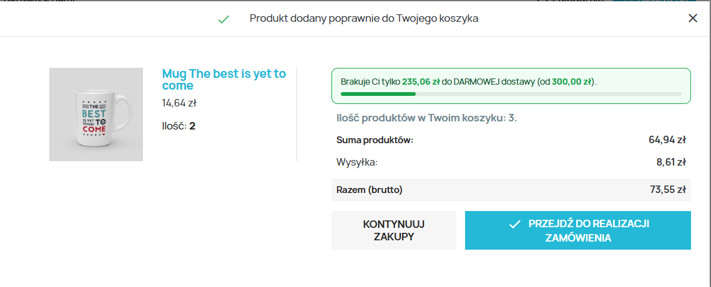
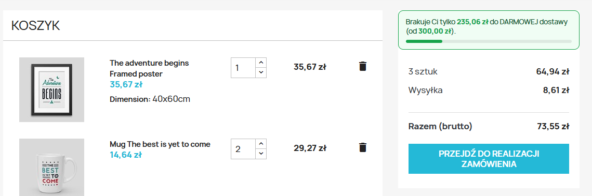
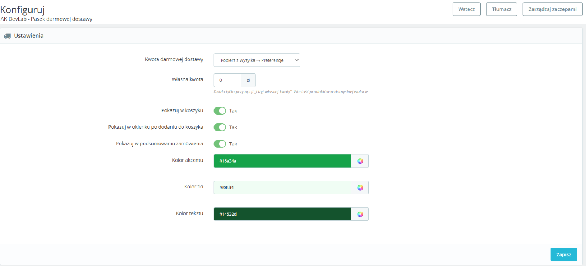

# AK DevLab – Pasek darmowej dostawy (Free Shipping Bar)

Pokazuje klientowi, ile brakuje mu do darmowej dostawy – w koszyku, w okienku po dodaniu produktu i w podsumowaniu zamówienia. Pasek postępu zachęca do dorzucenia jeszcze jednego produktu.

**Darmowy moduł do PrestaShop od [AK DevLab](https://github.com/akdevlab-pl).**

| | |
|---|---|
| Wersja | 1.0.0 |
| PrestaShop | 1.7.8 – 8.x (przetestowany na 8.2.9) |
| PHP | 7.2+ |
| Licencja | MIT |

## Co robi

- Komunikat „Brakuje Ci tylko 45,00 zł do DARMOWEJ dostawy” z paskiem postępu.
- Po przekroczeniu progu: „Masz DARMOWĄ dostawę!”.
- Odświeża się od razu po zmianie koszyka, bez przeładowania strony.
- Kwota progu pobierana z **Wysyłka → Preferencje** albo wpisana własna (liczy się wartość produktów).
- Przelicza próg na walutę klienta i formatuje kwotę według jego języka.
- Własne kolory (akcent, tło, tekst) i wybór miejsc, w których pasek się pokazuje.
- Wersja polska i angielska.

## Instalacja

1. Pobierz `akdl_freeship.zip` z zakładki **Releases**.
2. W panelu PrestaShop: **Moduły → Menedżer modułów → Załaduj moduł** i wskaż plik ZIP.
3. Kliknij **Konfiguruj** i ustaw kwotę oraz kolory.

## Zrzuty ekranu

**Okienko po dodaniu do koszyka**

**Koszyk**

**Ustawienia w panelu**

## Wsparcie

Błędy i pomysły zgłaszaj w zakładce **Issues**. Potrzebujesz modułu na zamówienie? Napisz do AK DevLab.

---

## English

Shows customers how much is left to free shipping in the cart, the add-to-cart popup and the checkout summary, with a progress bar.

- Threshold taken from *Shipping → Preferences* or your own amount.
- Converted to the customer's currency and formatted for their language.
- Custom colours and display places. English and Polish included.

**Install:** download `akdl_freeship.zip` from **Releases**, then go to *Modules → Module Manager → Upload a module*.

Compatible with PrestaShop 1.7.8 – 8.x. Released under the MIT license.
